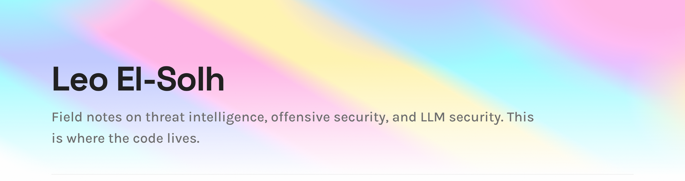

Self-taught security researcher and Go developer, based in Sweden.

- **CVE-2026-69263**: bypass of a critical RCE fix in FlowiseAI ([advisory](LINK))
- Bug bounty research since 2024, with findings reported to OpenAI
- Focus: web security, LLM and AI-agent security, Linux, Go

**Building now**
- MCP config scanner: finds security issues in MCP server configurations
- [GoPot](LINK): SSH honeypot in Go, live and logging real attacks
- [SIEM](LINK): log pipeline in Go, from raw logs to alerts

Studying for eJPT. Open to junior security and Go roles: leoelsolh@gmail.com
